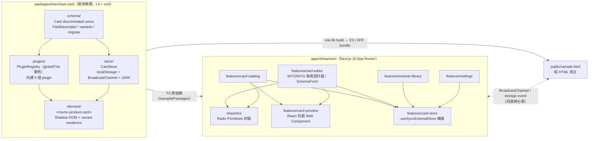

# Merchant Card Showroom

momo 商品卡的 **領域模型 + 框架無關卡片元件 + Showroom 調整介面 + 跨宿主嵌入與狀態同步**。

> 題目 B：分析真實 momo 商品卡類型，建立 Card Showroom。
> 本 repo 的重點不在「把卡片畫得像」，而在「讓一張卡片能被多個團隊、多種宿主長期安全地使用與擴充」。

## 快速開始

```bash
npm install
```

```bash
npm run dev        # 先建置 card bundle，再啟動 Next.js（http://localhost:3000）
```

| 網址 | 內容 |
| --- | --- |
| `/` | 商品卡類型分析 + 目錄（可依類型 / 版型篩選，條件存在 URL） |
| `/cards/[id]` | Schema 驅動的編輯器 + 即時預覽 + 事件紀錄 |
| `/sample.html` | 純 HTML 宿主頁面，一行 `<script>` 嵌入商品卡 |

**建議的 Demo 路徑**：開 `/cards/flash-earbuds`，再按「在 sample.html 開啟 ↗」並排兩個視窗——在編輯器改價格 / 開關插件，sample.html 即時更新；在 sample.html 按 ♡ / 🛒，編輯器的互動狀態同步改變。

其他指令：

```bash
npm test           # merchant-card 單元測試（vitest，18 個）
```

```bash
npm run test:e2e   # Playwright E2E（18 個；自動 build 並以 next start 在 3100 埠啟動）
```

首次執行 E2E 前需安裝瀏覽器：

```bash
npx --prefix apps/showroom playwright install chromium
```

```bash
npm run typecheck && npm run lint && npm run build
```

---

## 架構總覽



### Repo 結構

```
packages/merchant-card/src
├── schema/        領域模型：card.schema（zod）、variants（metadata + 欄位）、fields、migrate、fixtures
├── core/          純函式：價格 / 折數 / 倒數
├── plugins/       types（CardPlugin / slot）、registry、builtin/
├── store/         card-store（同步引擎）、merge（LWW）、shared-store（頁面單例）
├── element/       momo-product-card（Lit）、styles（tokens）、variants/（各 variant 專屬呈現）
├── index.ts       純邏輯入口：可在 SSR / Node import，不註冊 Custom Element
└── element/index.ts  瀏覽器入口：註冊內建 plugin + customElements.define

apps/showroom/src
├── app/           路由殼（Server Components），只負責組合 feature
│   ├── page.tsx              / 商品卡目錄
│   ├── cards/[id]/           layout（編輯器外框）＋ page（設計）＋ inspect/（檢視器）
│   ├── modules/ analysis/ embed/ settings/   模組庫、類型分析、嵌入指南、設定與同步
├── features/
│   ├── card-store/      React ↔ Store / Plugin Registry 唯一橋接點
│   ├── card-preview/    唯一可以載入 Web Component 的地方
│   ├── card-catalog/    目錄、篩選、類型分析
│   ├── card-editor/     WYSIWYG 設計器（模組面板 / 畫布 / 屬性面板）、檢視器
│   ├── module-library/  已註冊模組一覽
│   └── settings/        同步診斷、全部重設、介面偏好
└── shared/        ui（Radix 封裝、icons）、layout（App Shell sidebar、PageHeader）、lib
```

**Feature 邊界由 ESLint 強制**（`apps/showroom/eslint.config.mjs`）：

- 跨 feature 只能透過 `@/features/<name>`（index）引用，不能深入內部檔案
- feature 不可直接 import `radix-ui`，只能用 `@/shared/ui`
- `@momo/merchant-card/element` 只能由 `card-preview` 載入
- `shared` 不可依賴 `features`

---

## 設計重點

### 1. 領域模型：variant × extensions × layout 三個正交維度

分析 momo 搜尋頁、限時瘋搶、直播、排行榜後，把「一張商品卡」拆成：

| 維度 | 內容 | 變動頻率 | 實作方式 |
| --- | --- | --- | --- |
| **variant**（業務型態） | 一般 / 限時搶購 / 直播 / 排行榜 | 低 | zod discriminated union，各有專屬必填欄位 |
| **extensions**（行銷附加資訊） | 快速到貨、折價券、贈品、分期、曝光追蹤… | **高** | Plugin，核心 schema 只保留開放 record |
| **layout**（呈現） | 直式 grid / 橫式 list | — | 卡片預設值 + 宿主可覆寫 |

最常變動的「行銷標籤」被移出核心 schema，是整個架構最關鍵的取捨：行銷活動每週都在換，不應該每次都改卡片核心並重新發版給所有宿主。

### 2. Schema 驅動：一份定義，三處使用

`FieldDescriptor`（`text / number / boolean / select / countdown`）同時被 variant 與 plugin 用來宣告「可調整的欄位」：

- **卡片**用 zod schema 驗證資料
- **編輯器**用 `SchemaForm` 自動產生 Radix 控制項
- **目錄頁的類型分析**直接從 `VARIANTS` 表產生，文件不會與程式碼脫節

新增 plugin → 編輯器自動出現開關與欄位，不需改編輯器。新增 variant → TypeScript 的 mapped type 會強制補上 renderer（`variantRenderers`）與表單分支（`FieldControl` 的 exhaustive switch）。

### 3. Plugin 擴充：slot + render + lifecycle

```ts
registerPlugin({
  id: "double11",
  slot: "media-top",                    // media-top / media-bottom / badges / price-extra / footer
  defaults: { text: "11.11" },
  fields: [{ kind: "text", key: "text", label: "角標文字" }],
  configSchema,                         // 可選：任何具 safeParse 的物件（zod 相容）
  render: ({ config }) => html`<span class="tag tag--solid">${config.text}</span>`,
  setup: ({ host, emit }) => cleanup,   // 可選：無 UI 的生命週期（例如曝光追蹤）
});
```

韌性設計：

- **未註冊的 extension** 保留資料但不渲染（向前相容：新版 Showroom 加的 plugin，舊宿主不會壞）
- **config 不合法**時退回 defaults 並警告；**render / setup 拋錯**只影響該 plugin
- Registry 掛在 `globalThis`（`Symbol.for`），同頁多份 bundle 共用；註冊後所有卡片自動重繪

#### 所見即所得模組編輯（`placements`）

plugin 宣告的 `slot / order` 只是**預設值**；每張卡片可用 `placements[pluginId] = { slot, order }` 覆寫位置。
「啟用與設定」（`extensions`）和「擺在哪」（`placements`）分開存放，plugin 不需要知道自己被搬到哪。

- 卡片加上 `editable` attribute 進入編輯模式：插槽以 `data-slot` 標示並顯示為放置區、模組包在 `[data-plugin-id][draggable]` 內；**卡片本身不認識編輯器**
- 拖放邏輯在宿主：原生 HTML5 DnD 事件是 composed，`composedPath()` 取得 shadow 內的模組、`shadowRoot` 查詢插槽幾何算出插入位置（不用 dnd-kit：函式庫的碰撞偵測拿不到 Shadow DOM 內部節點）
- 版位運算是套件內的純函式（`placePlugin / removePlugin / shiftPlugin / slotOrder`，有單元測試），直接作用在未驗證的草稿上
- 鍵盤 / 觸控替代方案：模組面板「＋」加入、屬性面板換插槽 / 上下移動 / 移除

### 4. 跨宿主狀態一致性

```
寫入：validate → rev+1 → 記憶體 → read-merge-write localStorage → BroadcastChannel 廣播
接收：BroadcastChannel（即時）＋ storage event（備援）→ migrate → validate → LWW 合併
```

- **Last-Writer-Wins**：`rev` 大者勝，同 `rev` 以 `origin`（分頁 UUID）字典序決勝 → 訊息亂序、並發寫入都保證收斂（有單元測試）
- **read-merge-write**：寫 localStorage 前先合併其他分頁剛寫入但訊息未到的資料，避免整包覆蓋
- **設定**（Showroom 編輯）與**互動狀態**（收藏 / 購物車，任何宿主產生）分開存放、同一套同步
- **Schema 版本**：讀到舊版資料自動遷移並寫回（v1 `badges[]` → v2 `extensions` → v3 `placements`）；讀到**較新**版本（新部署的分頁寫入）時進入唯讀，避免舊程式碼把新資料寫壞
- 所有外部輸入（屬性、localStorage、訊息、分享連結）都過同一個 `parseCard` 邊界

### 5. Web Component 封裝

- 三種資料來源：`.card` property（框架宿主）、`data` JSON attribute（SSR / CMS）、`card-id`（接 Store 同步）
- Shadow DOM 隔離宿主的全域樣式（sample.html 刻意加了汙染樣式驗證）；`--momo-card-*` CSS 變數與 `::part()` 開放主題客製
- 對外事件全部 `bubbles + composed`：`momo-card:click / favorite-change / add-to-cart / impression / error`
- 錯誤同時提供可查詢狀態（`invalid` attribute、`issues` getter）：首次渲染的事件可能早於宿主掛監聽器
- 資料錯誤時顯示錯誤狀態並發出 `momo-card:error`，而不是白畫面
- Showroom 預覽用的是**同一個** Web Component（React 包裝），保證「Showroom 所見 = 宿主嵌入所得」

### 6. Browser-side Persistence 分層

| 狀態 | 存放 | 理由 |
| --- | --- | --- |
| 卡片設定、互動狀態 | localStorage + BroadcastChannel | 要跨分頁 / 跨宿主共享 |
| 目錄篩選條件 | URL search params | 可分享、可上一頁，不該汙染共享狀態 |
| 分享特定設定 | URL `?config=`（base64url） | 開啟時**先驗證、再詢問**是否套用，不默默覆蓋本地 |
| 編輯中的不合法草稿 | React local state | 不寫入、不廣播，避免壞資料擴散 |

---

## 取捨與刻意不做

| 優先 | 項目 | 狀態 / 理由 |
| --- | --- | --- |
| P0 | 領域模型、Schema 驗證、版本遷移 | ✅ 所有其他功能的地基 |
| P0 | Web Component + sample.html | ✅ 題目核心需求，也是跨團隊交付的實際形態 |
| P0 | 跨宿主同步、LWW 收斂 | ✅ 以單元測試覆蓋並發與亂序 |
| P0 | Plugin Registry、Schema 驅動編輯器 | ✅ |
| P1 | 刪除卡片 / 新增卡片 | ❌ LWW 刪除需要 tombstone，時間內不做；目前只有「重設」 |
| P1 | 卡片 SSR（Declarative Shadow DOM） | ❌ 卡片目前 client-only，對 SEO / LCP 不利，見演進方向 |
| P1 | E2E 測試 | ✅ Playwright 18 個：目錄篩選、編輯器 ↔ sample.html 雙向同步、驗證錯誤不廣播、持久化、分享連結、Shadow DOM 隔離、執行期 plugin |
| P2 | 視覺回歸測試 | ❌ 下一步以 Playwright screenshot 或 Chromatic 對 variant × plugin 組合做基準圖 |
| P2 | 真實 momo 圖片與資料 | ❌ 題目要求不呼叫真實網站，使用 SVG placeholder 與虛構商品 |
| P2 | Dark mode、i18n | ❌ 非評估重點 |

已知限制：

- **bundle 大小**：IIFE 約 43KB gzip，其中 zod 佔大半。可改用 `zod/mini` 或於 build time 產生 validator 壓到 ~15KB
- **跨網域宿主**：BroadcastChannel / localStorage 只在同源有效。真實情境中宿主在不同網域時，需改為 `postMessage` + iframe hub 或後端同步（Store 的 `channel` / `storage` 已是可注入介面，見演進方向）
- **LWW 是整筆紀錄粒度**：兩個分頁同時改同一張卡的不同欄位，後寫者會覆蓋前者。對「單人在多分頁操作」足夠；多人協作需改為欄位級 LWW 或 CRDT

---

## 後續演進方向

1. **跨網域同步**：實作 `SyncChannel` 的 `postMessage` / WebSocket adapter，Store 本體不用改
2. **SSR**：以 Lit SSR 或 Declarative Shadow DOM 輸出首屏 HTML，改善商品列表的 LCP
3. **Plugin 治理**：plugin 加上 `version` 與相容的 schema 版本範圍；Registry 支援遠端 manifest，行銷團隊可不經發版上架 plugin
4. **可觀測性**：`momo-card:error` / `impression` 事件統一導向埋點 SDK；Store 遷移失敗與唯讀事件上報
5. **驗證**：以 Storybook / Chromatic 對 variant × plugin 組合做視覺回歸；E2E 接上 CI
6. **Bundle**：`zod/mini` + 依 variant 拆分 renderer

---

## Human–Agent 協作紀錄

本專案由我（候選人）與 Claude Code 協作完成，commit 皆附 `Co-Authored-By`。協作方式：

1. **先定契約、再讓 Agent 填實作**：先確定 `CardSchema`、`FieldDescriptor`、`CardPlugin`、`CardStore` 介面，再實作 renderer、編輯器
2. **重大決策由人拍板**（詳見 [PRD.md](PRD.md) 決策紀錄）：卡片核心採框架無關（Lit）而非 React 包 WC、Radix Primitives 而非 Themes、Tailwind v4 + 卡片純 CSS、以 feature 為單位 commit
3. **關鍵修正點**（Agent 初版 → 人工審視後修正）：
   - Plugin `configSchema` 原本強制 zod 型別，IIFE 需 re-export 整包 `z` → bundle 107KB；改成 duck-typed `safeParse` 介面後降到 42KB
   - `useCardActions` 初版在 render 期間建立 Store，SSR 時會在 server 端 seed 資料；改為延遲取得
   - Next.js 16 Cache Components 對 `params` 存取的限制，改為 Suspense 內 await
   - emoji 圖示在品牌色底上不可辨識（瀏覽器實測發現），改 SVG
   - **E2E 抓到的真 bug**：資料錯誤的 `momo-card:error` 在 bundle 載入、元素升級的當下就發出，早於宿主掛監聽器而遺失。
     修正為「事件 + 可查詢狀態」雙管道（`invalid` attribute、`issues` getter），sample.html 也改為先掛監聽再載入 bundle
4. **驗證方式**：vitest 覆蓋 schema / migration / plugin / 同步收斂；Playwright E2E 以同一 browser context 開多個分頁，驗證編輯器 ↔ sample.html 雙向同步、驗證錯誤 UI、分享連結、Shadow DOM 隔離、執行期 plugin 註冊
