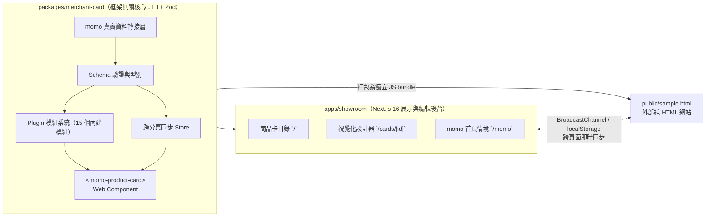

# Merchant Card Showroom（momo 商品卡展示與設計系統）

這是一個為 **momo 商品卡** 打造的 **跨框架元件庫 + 視覺化設計後台（Showroom）**。

> **核心目標（題目 B）**：不只把商品卡「畫得像」，而是建立一套 **能讓多個團隊、不同前端框架長期共用與擴充** 的商品卡系統。

---

## 🚀 快速開始

```bash
npm install
npm run dev
```

啟動後打開 **http://localhost:3000** 即可體驗。

### 推薦體驗的 3 個亮點流程

1. **視覺化調整商品卡（`/cards/flash-earbuds`）**
   - 右側面板可隨時修改標題、價格、切換「直式 / 橫式」版型。
   - 切到「**模組**」分頁：可自由開關 15 種模組（速達、折價券、贈品、收藏、加入購物車多樣式等），或在左側畫布直接**拖曳模組換位置**。
2. **跨頁面即時同步（編輯器 ↔ 外部網站）**
   - 在編輯器右上角點「**在 sample.html 開啟 ↗**」，把兩個視窗並排。
   - 在編輯器改價格或開關標籤，`sample.html`（純 HTML 頁面）會**零延遲同步更新**；在 `sample.html` 點愛心收藏，編輯器也會同步亮起。
3. **momo 首頁真實資料情境（`/momo`）**
   - 以真實 momo 首頁 API 資料（內建離線快照，也可切換即時連線）渲染「限時搶購、精選好物榜、橫式輪播、你可能會喜歡」四大區塊。
   - 點區塊右上角「**調整此區樣式**」去改代表卡（例如把購物車按鈕改成「整條按鈕」或換版型），整個首頁區塊的所有商品卡會**即時套用新樣式**。

---

## 🧭 頁面導覽

| 路徑 | 說明 |
| --- | --- |
| `/` | **商品卡目錄**：瀏覽、篩選所有商品卡，也可點「＋ 新增卡片」建立自訂商品卡 |
| `/cards/[id]` | **卡片設計器**：左側即時畫布（支援拖曳排版）＋ 右側內容 / 模組設定面板 |
| `/cards/[id]/inspect` | **檢視器**：查看卡片背後的 JSON 資料結構與即時觸發的 DOM 事件紀錄 |
| `/momo` | **momo 首頁情境**：用真實 momo 資料展示四大區塊，支援一鍵匯入目錄與樣式同步 |
| `/sample.html` | **純 HTML 嵌入範例**：示範非 React 網站如何用一行 `<script>` 嵌入商品卡 |
| `/modules` | **模組庫**：查看系統內建的 15 個擴充模組與預設插槽 |
| `/analysis` | **類型分析**：商品卡拆解思路與 momo 首頁 API 資料格式整理 |
| `/embed` | **嵌入指南**：提供給其他團隊的 Web Component 串接說明 |
| `/settings` | **設定與同步**：跨分頁同步狀態診斷、一鍵重設所有本地資料 |

---

## 🏗️ 專案結構

專案採用 `npm workspaces` 管理兩個套件，確保「**商品卡核心完全不依賴 React 後台**」：



```text
├── packages/merchant-card/   # 商品卡核心套件（可獨立發布給各團隊使用）
│   └── src/
│       ├── schema/           # 商品卡資料格式定義（Zod）與版本自動遷移（v1 → v5）
│       ├── plugins/          # 外掛模組註冊表、版位運算與 15 個內建模組
│       ├── store/            # 跨分頁狀態同步引擎（localStorage + BroadcastChannel）
│       ├── adapters/momo/    # momo 首頁 API 轉換器、樣板套用與離線快照
│       └── element/          # <momo-product-card> Web Component 本體
│
└── apps/showroom/            # Next.js 16 展示與編輯後台
    ├── src/app/              # 頁面路由
    ├── src/features/         # 功能模組（目錄、設計器、momo 首頁、預覽包裝）
    ├── src/shared/           # 共用 UI 元件（Radix Primitives 封裝）與版面
    └── e2e/                  # Playwright 端到端測試
```

---

## 💡 五大核心設計（為什麼這樣設計？）

### 1. 商品卡拆解：把「常變的行銷標籤」變成外掛模組

觀察 momo 全站商品卡後，我們將一張卡片拆成三個獨立維度：

| 維度 | 內容舉例 | 變動頻率 | 設計方式 |
| --- | --- | --- | --- |
| **業務類型（Variant）** | 一般商品、限時搶購、直播、排行榜 | 低 | 核心支援 4 種類型，各自擁有專屬欄位（如倒數計時、名次、觀看數） |
| **擴充模組（Plugins）** | 速達、折價券、登記、贈品、雙11角標、收藏、加入購物車 | **極高** | **抽離核心**，做成 15 個可自由開關、拖曳換位置的插槽模組 |
| **呈現版型（Layout）** | 直式（Grid）、橫式（List） | 中 | 同一份商品資料可隨時切換直式或橫式呈現 |

> **好處**：行銷團隊每週推出新活動標籤時，只要新增一個幾十行的 Plugin，**不用修改商品卡核心，也不用要求所有外部網站重新更新版本**。連「收藏愛心」與「加入購物車（支援圓形圖示、整條按鈕、右下「搶」頁籤等 5 種樣式）」也都是可插拔模組。

### 2. Schema 驅動：寫一份定義，自動長出驗證與表單

每個卡片類型與模組只需宣告一次欄位描述（`FieldDescriptor`）：
- **資料層**自動用 Zod 檢查型別與數值範圍（例如特價不可高於原價）。
- **編輯器**自動根據欄位定義渲染出對應的輸入框、下拉選單與開關。
- 新增一個模組時，**完全不用改編輯器程式碼**，設定面板就會自動出現它的控制項。

### 3. Web Component 封裝：任何網站一行 `<script>` 就能用

商品卡本體使用輕量的 **Lit Web Component**（`<momo-product-card>`）實作：
- **樣式隔離（Shadow DOM）**：外部網站的 CSS（例如全域 `button { all: unset }`）不會弄壞商品卡；同時開放 `--momo-card-*` CSS 變數讓外部微調主題色。
- **標準事件**：點擊卡片、收藏、加入購物車都會發出標準 CustomEvent（`momo-card:add-to-cart` 等），方便外部網站接購物車或埋點。
- **Showroom 零落差**：Showroom 後台預覽畫布裡渲染的，就是**同一顆 Web Component**，保證「在後台看到的樣子 = 嵌入到外部網站的樣子」。

### 4. 跨頁面狀態同步與防呆

為了讓 Showroom 與 `sample.html`（或多個開啟的分頁）保持一致：
- **即時同步**：透過 `BroadcastChannel` 即時廣播變更，並以 `localStorage` 持久化保存。
- **衝突解決（Last-Writer-Wins）**：每次修改帶有遞增版本號（`rev`），多視窗同時操作也能確保最終畫面一致。
- **錯誤不擴散**：在編輯器輸入不合法的數字時，只會在表單顯示紅字提示，**不會把壞資料存進資料庫或廣播給其他頁面**。
- **自動升級（Schema Migration）**：瀏覽器裡若有舊版格式的卡片資料（v1 ~ v4），讀取時會自動無痛升級到最新 v5 格式。

### 5. momo 真實資料轉接層（Adapter）

在 `packages/merchant-card/src/adapters/momo` 中實作了完整的資料清洗與轉換層：
- 將 momo 首頁 API 的原始欄位（千分位價格字串、各種行銷 icon 代碼、銷量文字、YouTube 影片）轉換並驗證為標準 `Card` 格式。
- **樣板同步（Template Sync）**：在編輯器修改目錄中的「代表樣板卡」，會透過 `applyCardTemplate` 即時套用到 `/momo` 首頁對應區塊的所有真實商品上，同時保留各商品原本的促銷標。

---

## 🧪 測試與品質把關

常用開發與檢查指令：

```bash
npm test             # 執行 47 個單元測試（Vitest：涵蓋 Schema、版本遷移、Plugin、多視窗同步、momo 資料轉換）
npm run test:e2e     # 執行 33 個端到端測試（Playwright：涵蓋目錄、拖曳設計器、跨分頁雙向同步、momo 首頁情境）
npm run typecheck    # TypeScript 型別檢查
npm run lint         # ESLint 檢查（包含強制檢查 Feature 模組邊界）
npm run build        # 打包 Web Component bundle 與 Next.js 正式環境建置
```

> 首次執行 `npm run test:e2e` 前，若尚未安裝測試瀏覽器，請先執行：
> `npx --prefix apps/showroom playwright install chromium`

---

## ⚖️ 取捨與未來演進方向

### 本階段取捨
- **同網域同步 vs 跨網域同步**：目前使用瀏覽器原生的 `BroadcastChannel` + `localStorage`（限同源網站）。若未來要跨不同網域同步，Store 已預留介面，替換為 WebSocket 或 `postMessage` 即可，不需改動卡片與 UI。
- **Bundle 體積**：獨立打包的 IIFE bundle 約 51KB（gzip），其中 Zod 驗證庫佔了約一半。正式生產環境可改用 `zod/mini` 進一步縮小至 ~20KB。
- **預設使用離線快照**：`/momo` 頁面預設讀取預先錄製的真實 API 快照，確保面試官在任何網路環境都能穩定預覽，並提供按鈕可一鍵切換為即時向 momo 伺服器抓取。

### 下一步可演進方向
1. **伺服器端渲染（SSR）**：結合 Declarative Shadow DOM，讓商品卡在首屏 HTML 就完成渲染，進一步提升 SEO 與 LCP 速度。
2. **遠端模組熱更新**：讓行銷團隊直接從後台發布新標籤設定檔（JSON Manifest），前端動態載入，完全免發版。
3. **視覺回歸測試**：在 CI 加入 Playwright 截圖比對，確保每次改動不會影響各版型與標籤組合的視覺細節。

---

## 🤝 AI 協作說明（Human–Agent Collaboration）

本專案由候選人主導架構設計，並與 AI Coding Agent 協作開發完成（詳細決策演進請見 [`PRD.md`](PRD.md) 與 [`Progress.md`](Progress.md)）：

- **人類負責定義邊界與拍板關鍵決策**：包含將卡片核心獨立為 Lit Web Component、將行銷標籤抽離為 Plugin、定義跨分頁同步機制、以及對齊真實 momo 首頁的資料轉接架構。
- **自動化測試護欄**：每個階段皆透過 Vitest 單元測試與 Playwright 多分頁 E2E 測試驗證（例如透過 E2E 抓出並修正了 Custom Element 初次升級時錯誤事件早於監聽器掛載的時序問題）。
